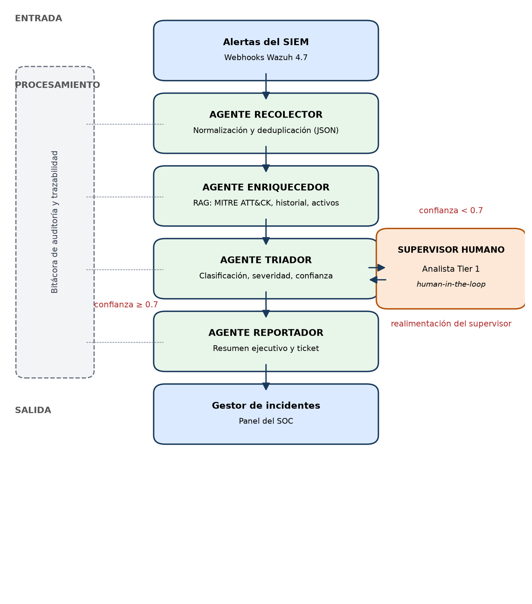
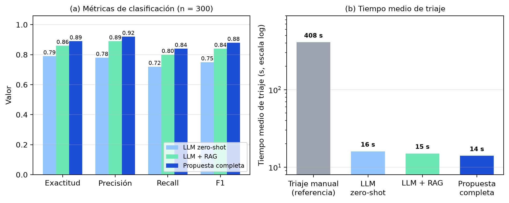

# Workflow Automatizado con Agentes de IA para el Triaje Inicial de Alertas de Ciberseguridad

Repositorio de evidencias y código del trabajo extraclase: **workflow automatizado
basado en agentes de inteligencia artificial para el triaje inicial de alertas de
ciberseguridad**, integrado con el SIEM Wazuh y sustentado en un LLM desplegado
localmente (Llama 3.1 8B con Ollama).

Autores:

- **Pérez Alonso, Rafael Antonio** — Universidad de las Ciencias Informáticas (UCI), ORCID: 0009-0012-4455-6681
- **Collymore Blez, Ronald** — UCI, ORCID: 0009-0034-7789-1121
- **Paneque Acosta, Christian** — UCI, ORCID: 0009-0056-9910-2246

## Resumen

Los centros de operaciones de seguridad (SOC) procesan volúmenes de alertas que
exceden la capacidad de análisis de los analistas, lo que genera fatiga de alertas,
falsos negativos y tiempos de respuesta elevados. Este trabajo desarrolla un
workflow automatizado con cuatro agentes especializados:

| Agente | Función | LLM |
|---|---|---|
| **Recolector** | Normaliza la alerta de Wazuh a un esquema JSON común, deduplica por hash y sanea datos personales | No (determinista) |
| **Enriquecedor** | RAG: recupera técnicas MITRE ATT&CK, incidentes históricos (FAISS) y contexto del activo | No (recuperación) |
| **Triador** | Clasifica (VP/FP/Benigno), asigna severidad, técnica ATT&CK, justificación y confianza | Sí (temp 0.1) |
| **Reportador** | Genera resumen ejecutivo (≤150 palabras), ticket y acciones de respuesta sugeridas | Sí (temp 0.4) |

Regla de gobierno: toda alerta con **confianza < 0.7**, o clasificada como
verdadero positivo con **severidad crítica o alta**, pasa obligatoriamente al
supervisor humano (human-in-the-loop).

## Resultados (n = 300 alertas)

| Configuración | Exactitud | Precisión | Recall | F1 | MTT (s) |
|---|---|---|---|---|---|
| LLM zero-shot | 0.79 | 0.78 | 0.72 | 0.75 | 16 |
| LLM + RAG | 0.86 | 0.89 | 0.80 | 0.84 | 15 |
| **Propuesta completa** | **0.89** | **0.92** | **0.84** | **0.88** | **14** |

Otros indicadores clave:

- Tiempo medio de triaje: **14 s/alerta** frente a **6.8 min** del proceso manual (reducción del 96 %).
- Reducción de la carga manual de triaje: **66 %** (34 % de alertas escaladas al supervisor).
- Justificaciones con afirmaciones no respaldadas por la evidencia: de **11.3 % a 2.7 %**.
- Confirmación humana de las recomendaciones del agente en los casos de baja confianza: **86 %**.

## Estructura del repositorio

```
├── docs/
│   ├── Trabajo-Extraclase-Workflow-Agentes-IA-Triaje-1.docx   # artículo completo
│   └── figuras/
│       ├── fig1_arquitectura.png      # arquitectura del workflow (Fig. 1)
│       └── fig2_metricas.png         # comparación de métricas (Fig. 2)
├── evidencias/
│   └── video_triaje_workflow-1.mp4   # demostración en vídeo del workflow
├── src/
│   ├── agents/
│   │   ├── recolector.py             # normalización, deduplicación, saneamiento
│   │   ├── enriquecedor.py           # RAG (MITRE ATT&CK + FAISS + inventario)
│   │   ├── triador.py                # clasificación con LLM local
│   │   └── reportador.py             # resumen ejecutivo y ticket
│   ├── prompts/
│   │   └── triador.txt               # prompt con guardrails éticos y de seguridad
│   ├── schemas.py                    # esquemas Pydantic (validación y reintentos)
│   ├── config.py                    # umbrales y parámetros calibrados
│   ├── workflow.py                   # grafo LangGraph con human-in-the-loop
│   ├── bitacora.py                   # bitácora inmutable de auditoría (SQLite)
│   └── main.py                      # servidor webhook para Wazuh
├── scripts/
│   └── evaluar.py                    # métricas sobre la referencia dorada
├── data/
│   ├── ejemplos/alerta_wazuh.json    # alerta de ejemplo
│   ├── resultados/                   # Tabla II e indicadores clave
│   └── mitre/attack.json             # extracto del corpus ATT&CK
└── requirements.txt
```

## Requisitos e instalación

1. **Ollama** con el modelo local:

   ```bash
   ollama pull llama3.1:8b-instruct
   ollama serve   # http://localhost:11434
   ```

2. **Dependencias de Python 3.11+**:

   ```bash
   pip install -r requirements.txt
   ```

3. **Wazuh 4.7** configurado para enviar alertas al webhook
   `http://<host>:8080/wazuh/alerts`.

## Uso

```bash
# Procesar una alerta de ejemplo (demo)
python -m src.main --demo

# Servidor webhook para Wazuh
python -m src.main

# Evaluar métricas sobre predicciones
python -m scripts.evaluar data/resultados/predicciones_propuesta.csv
```

## Arquitectura



Las alertas ingresan por webhooks desde Wazuh; cuatro agentes especializados las
procesan de forma secuencial compartiendo un estado común; la salida se deposita
en el gestor de incidentes y en el panel del SOC; y un supervisor humano
interviene cuando la confianza del agente triador es inferior a 0.7. Cada
transición queda registrada en una bitácora inmutable de auditoría.



## Consideraciones éticas y normativas

El sistema se diseñó bajo el principio de **responsabilidad humana aumentada**,
no de autonomía plena: el agente reportador no ejecuta ninguna acción de
respuesta, las recomendaciones se registran para validación humana. El despliegue
local (sin salida de datos del perímetro) cumple por diseño la Ley 149/2022 de
Protección de Datos Personales de Cuba, los principios de minimización del
GDPR y las obligaciones de transparencia del Reglamento (UE) 2024/1689 (AI Act,
categoría de riesgo limitado).

## Vídeo de demostración

La demostración del funcionamiento del workflow se encuentra en
[`evidencias/video_triaje_workflow-1.mp4`](evidencias/video_triaje_workflow-1.mp4).

## Referencias principales

- Singh, Y. y Patel, N. D. — *Enhancing SOC efficiency through multi-model
  integration of LLMs and SIEM* (SSRN, 2024)
- Wei, B. et al. — *CORTEX: Collaborative LLM agents for high-stakes alert
  triage* (arXiv:2510.00311, 2025)
- Sheikhi, S. et al. — *Cognitive SOC: Evidence-backed narrative generation*
  (Univ. de Oulu, 2026)
- MITRE ATT&CK — https://attack.mitre.org
- Wazuh — https://documentation.wazuh.com
- LangChain / LangGraph — https://python.langchain.com

La lista completa de referencias (15) está en el artículo incluido en `docs/`.
